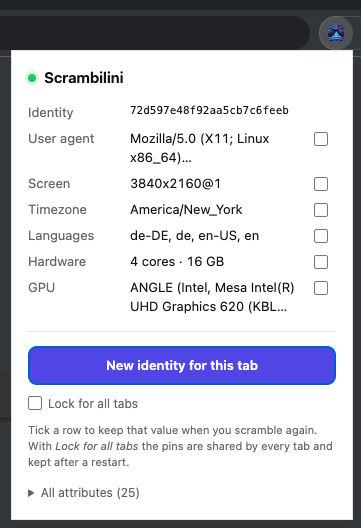
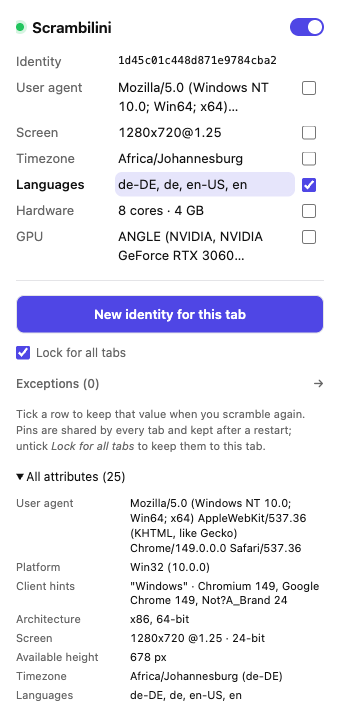
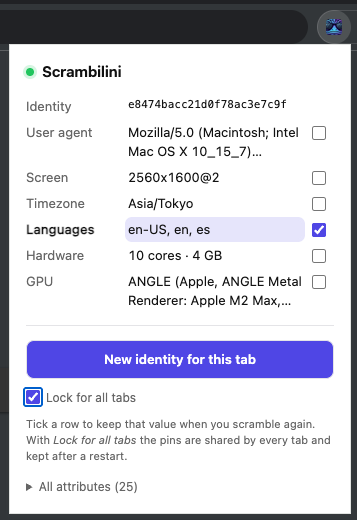

<p align="center">
  
</p>

# Scrambilini

A Chrome (MV3) extension that gives **every tab its own browser fingerprint**.
The same tab keeps one coherent identity across reloads and navigations, and a
new tab gets a new one — so fingerprinting services see a different, internally
consistent device each time you open a tab.

Both sides of the fingerprint are scrambled and kept in agreement:

- **JavaScript surface** — `navigator`, screen, timezone, languages, canvas,
  WebGL, WebGPU adapter info, audio, fonts, plugins, battery, connection, media
  devices, storage quota, speech voices, keyboard layout, `Intl` locale.
- **HTTP surface** — `User-Agent`, `sec-ch-ua*`, `Accept-Language`, `DNT`, sent
  through `declarativeNetRequest` header rules.

A tab can come out as macOS, Windows or Linux, and everything that gives the
platform away moves together: the UA string, `navigator.platform`,
`navigator.userAgentData`, `sec-ch-ua-platform`, the high-entropy hints, the GPU
strings, the plausible screen sizes and the set of system fonts the page can
enumerate.

The two are derived from the same seed with the same pure function
(`src/shared/profile.js`), so the headers a server sees and the values a page
reads describe the same machine.

<p align="center">
  
  
  
</p>

<p align="center"><sub>a fresh identity · the full attribute list · a language pinned for all tabs</sub></p>

## How it works

```
tabs.onCreated ──► service worker mints a seed ──► DNR session rule (per tab)
                        │                                  │
                        │                                  └─► first request already spoofed
                        ▼
             content script asks for the seed
                        │
                        ▼
      MAIN-world script builds the profile from that seed
      and patches the APIs a fingerprinter reads
```

- **`src/background.js`** owns identities. It mints a seed the moment a tab is
  created (so even the tab's first navigation carries the spoofed headers),
  stores it in `chrome.storage.session` under `tab:<tabId>`, and installs a
  per-tab `declarativeNetRequest` session rule (`id = 900000 + tabId`). All
  mutations for a tab are serialised through a per-tab promise queue.
- **`src/content/bridge.js`** (isolated world, `document_start`) gets the tab's
  seed and hands it to the page. It reads the seed straight out of session
  storage — which does not need the worker to wake up — and asks the worker in
  parallel; the worker's answer wins if the two ever disagree. The hand-off
  lands a few milliseconds after the document starts.
- **`src/content/scramble.js`** (MAIN world, `document_start`) builds the profile
  and replaces the getters/methods fingerprinters use. Until the worker answers
  it uses a provisional seed, then swaps the profile in place; every getter reads
  the live profile object, so the swap is cheap. Patched functions report
  `[native code]` through a patched `Function.prototype.toString`.
- **`src/shared/profile.js`** is the deterministic `(seed, realUserAgent) →
  profile` builder shared by the worker (`importScripts`) and the page.
- **`src/popup.html` / `src/popup.js`** show the current tab's identity and can
  roll a new one. Each row has a tick box that locks that value, so a scramble
  keeps it. The page swaps the identity in place, so the popup stays open and
  shows the new values immediately.

## Install

There is **no build step**: this folder *is* the extension, and Chrome loads the
source files directly. Nothing has to be installed to use it.

The test harnesses and the icon tool are TypeScript and run on
[Bun](https://bun.sh) with Playwright:

```bash
bun install      # only for the tests and the icon tool
```

`make build` is only for packaging: it checks the sources and writes
`dist/scrambilini-<version>.zip`. `make release` also writes a SHA-256 next to
it. `make icons` rebuilds `icons/` from the artwork. `make` on its own prints
the available targets. None of that is needed to load the extension.

1. Open `chrome://extensions`.
2. Turn on **Developer mode** (top right).
3. Click **Load unpacked**.
4. Select this folder — the one that contains `manifest.json`.

You can also drag the folder onto the `chrome://extensions` page while Developer
mode is on.

Chrome will **not** install a `.zip` by dragging it. If you need to move the
extension to another machine, unzip it first and then load the unzipped folder.
`make release` writes `dist/scrambilini-<version>.zip`; a built copy is also on
the [releases page](https://github.com/include/scrambilini/releases).

Every new tab gets a new identity automatically. Reloading a tab keeps the
identity it already has. Use the toolbar popup to see it or to roll a new one.

## Locking a value

The popup has a small tick box on the right of every row. Tick one and that
value is kept the next time you scramble; everything else is drawn again.

The rows are the headline values. **All attributes (25)** at the bottom expands
the full list the tab reports: platform version, client hints, architecture,
WebGL limits, fonts, voices, keyboard, storage, battery and the rest. Long
values are clamped in the headline rows and shown in full there.

For example: scramble until the languages look right, tick **Languages**, then
press **New identity for this tab** again. The languages stay put while the user
agent, screen, timezone, hardware and GPU come from the new seed, and the
canvas/audio noise changes as usual.

- Ticking a row does not change the current identity. It stores the value the
  tab already has.
- Unticking lets the seed decide that value again, so it can change at that
  moment. The popup and the page stay in step either way.
- **Lock for all tabs** shares the pins with every tab and keeps them after a
  browser restart. Tick it once and the language you pinned stays pinned
  everywhere; untick a row in a single tab to opt that tab out without touching
  the others.
- Without that toggle, locks belong to the tab: a new tab starts unlocked, and
  the locks are forgotten when the tab closes.
- A locked screen or GPU also pins the platform that owns it (macOS, Windows or
  Linux), so you do not end up with a Mac screen on a Windows user agent.
- Shared locks live in `chrome.storage.local` under `locks:global`; per-tab
  locks and per-tab opt-outs live in `chrome.storage.session` under
  `locks:<tabId>`. Both are applied by the same profile builder, so the headers
  follow the locks too.

## How the values are chosen

There are two separate steps, and the split is the whole design.

**Step 1 — one real random seed per tab.** The service worker calls
`crypto.getRandomValues` and gets 128 bits (`randomSeed` in
`src/background.js`). This happens in `tabs.onCreated`, before the tab navigates,
so the very first request already carries the spoofed headers.

**Step 2 — everything else is deterministic from that seed.** The profile builder
turns the seed into a number and runs a small PRNG over it (`build` in
`src/shared/profile.js`):

```js
const rnd = mulberry32(hashSeed(seed)());
const pick = (arr) => arr[Math.floor(rnd() * arr.length)];
const ri = (min, max) => min + Math.floor(rnd() * (max - min + 1));
```

Each `pick`/`ri` call takes the next number from that sequence. The result:

- **Same seed, same identity, always.** That is why the worker (which writes the
  headers) and the page (which reads `navigator.*`) agree without ever sending
  the profile to each other.
- **Reload keeps the identity**, because the seed is reused from storage.
- **Reseed makes a new identity**, because it makes a new random seed.
- There is no `Math.random()` anywhere in the profile.

## Static lists or made up on the spot?

A mix of all three:

| Kind | Examples | Where |
| --- | --- | --- |
| **Static catalog** (hand-written) | 3 operating systems, 31 screen sizes, 18 GPU strings with matching WebGPU adapters, 65 system font names, 44 macOS / 12 Windows / 12 Linux speech voices, 5 keyboard layouts, 6 core counts, 3 RAM sizes, 24 timezones, 17 language sets | `SYSTEMS`, `VOICES`, `WEBGPU_INFO` in `profile.js` |
| **Picked from the catalog** | OS, screen, GPU, fonts, voices, keyboard layout, cores, memory, timezone, languages, color depth, sample rate, DNT, platform version | `build()` |
| **Derived on the spot** | Chrome version = `realMajor - 0..4`; `Accept-Language` built with `q=0.9/0.8/0.7`; `availHeight = height - 25..90`; the UA string for the chosen OS; media device ids as random 32-char hex; storage quota and usage; the canvas/audio noise salt | `build()` |
| **Kept real on purpose** | the UA format, the client hint order, the `Chrome/xxx.0.0.0` shape | design choice |

Two honest notes:

- **The platform is scrambled, but only at the level a page can see.** The UA,
  `navigator.platform`, client hints, GPU strings and font list all move together,
  so a Windows identity does not leak Mac fonts through `document.fonts.check` or
  canvas text measurement. What cannot move is the real TLS/JA3 fingerprint and
  the real rendering engine, so a Windows UA still renders with Mac glyph shapes.
  That gap is invisible to the usual JS/HTTP fingerprinters, but it is not zero.
- **The visible entropy is finite.** The catalogs multiply to roughly 220 million
  combinations. What actually keeps two tabs apart is the canvas/audio noise salt,
  which is 32 bits derived from the seed (`build()`, `salt`).

## Verify

The `test/` folder drives a real Chromium with the extension loaded. It is
TypeScript on Bun with Playwright:

```bash
bun install     # once

# one at a time
bun run test/navtiming.ts     # headers at various delays after tab creation
bun run test/coherence.ts     # UA, platform hints, fonts and headers agree
bun run test/attributes.ts    # locale, speech voices and keyboard follow the identity
bun run test/reseed.ts        # reload keeps the identity, reseed changes it
bun run test/popup.ts         # the popup rolls and stays open
bun run test/locks.ts         # tick boxes survive a scramble and a reload
bun run test/persistence.ts   # "Lock for all tabs" survives new tabs and restarts
bun run test/amiunique.ts 3   # three tabs on amiunique.org

# or everything in order
make test
```

`bun run test/probe.ts [url ...]` prints what the page sees for any URL, and
`bun run test/debug.ts` dumps the tab seed, the stored seed and the installed
header rules.

`amiunique.ts` prints each tab's UA, language, cores, memory, screen and GPU
plus whether the HTTP headers and the JavaScript values agree, then reports how
many distinct identities it saw.

`coherence.ts` checks the things that have to agree with each other: the UA and
`navigator.platform` and `navigator.userAgentData.platform`, the
`sec-ch-ua-platform` header, and the font list (`document.fonts.check` and
canvas text measurement) against the platform the identity claims.

## Limitations

- **The first few milliseconds of a document** use a provisional identity: the
  page can only learn the tab seed asynchronously, so a script that runs before
  the hand-off lands (an inline `<script>` at the top of the document) sees a
  different — still internally consistent — identity than the request headers.
  The hand-off lands roughly 3–5 ms after the document starts, so anything that
  fingerprints on `DOMContentLoaded`/`load`, which is what real libraries do,
  gets the adopted identity.
- **A navigation started within a few milliseconds of a tab being created** can
  beat the header rule into place. In practice a tab is created long before a
  user navigates; the window only shows up in synthetic tests.
- **Only what a page can see is spoofed.** TLS/JA3, TCP/IP, and anything the
  browser exposes outside the patched APIs (e.g. `chrome.*`, permissions that
  are denied rather than faked) are untouched.
- **Canvas/WebGL/audio noise is deterministic per tab**, not per read, so the
  same tab keeps returning the same values.
- **Only the font list is faked, not the glyphs.** `document.fonts.check` and
  canvas text measurement follow the identity's platform. The text a page
  actually draws still uses the real system fonts of the machine.
- **A few attributes are deliberately left real.** `canPlayType`, media
  capabilities and permission states are identical on every Chrome build of the
  same version, so spoofing them would add risk (broken playback, odd prompts)
  for no entropy. They do not tell your tabs apart. The same goes for the WebGL
  extension list, shader precision, `performance.memory` and
  `screen.orientation`: measured on this Chrome, they are constants, so faking
  them would only add a way to get them wrong.
- **WebGPU reports the identity's adapter.** `navigator.gpu.requestAdapter()
  .info` follows the GPU the tab claims: `apple`/`metal-3` for a Mac identity,
  `nvidia`/`ampere`, `intel`/`gen-12lp` or `amd`/`rdna-2` for the others.
- **Speech voices, the `Intl` locale and the keyboard layout are per tab.** The
  voice set is a seed-chosen subset of the platform catalog, dates and numbers
  format in the identity's language, and `navigator.keyboard` reports the layout
  that goes with it (AZERTY for French, QWERTZ for German, otherwise QWERTY).

## Layout

```
manifest.json
package.json             Bun tooling (tests + icon tool); ignored by Chrome
Makefile                 make build / make release / make icons
src/background.js        service worker: seeds, DNR rules, locks, reseed
src/shared/profile.js    deterministic profile builder (worker + page)
src/content/bridge.js    isolated-world seed hand-off
src/content/scramble.js  MAIN-world API patching
src/popup.html/.js       identity inspector, locks, reseed
icons/                   icon16/32/48/128.png, generated by tools/icons.ts
tools/icons.ts           crops and resizes images/scrambilini.png into icons/
tools/check.ts           manifest, syntax and profile-builder checks
images/                  the artwork and the screenshots in this README
test/                    Bun + Playwright harnesses (harness, probe, navtiming,
                         coherence, attributes, reseed, popup, locks,
                         persistence, amiunique, debug)
dist/                    scrambilini-1.6.0.zip — ignored, built by make release
```
